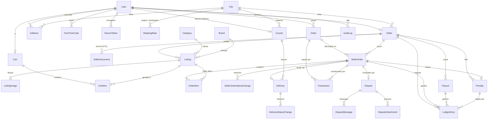
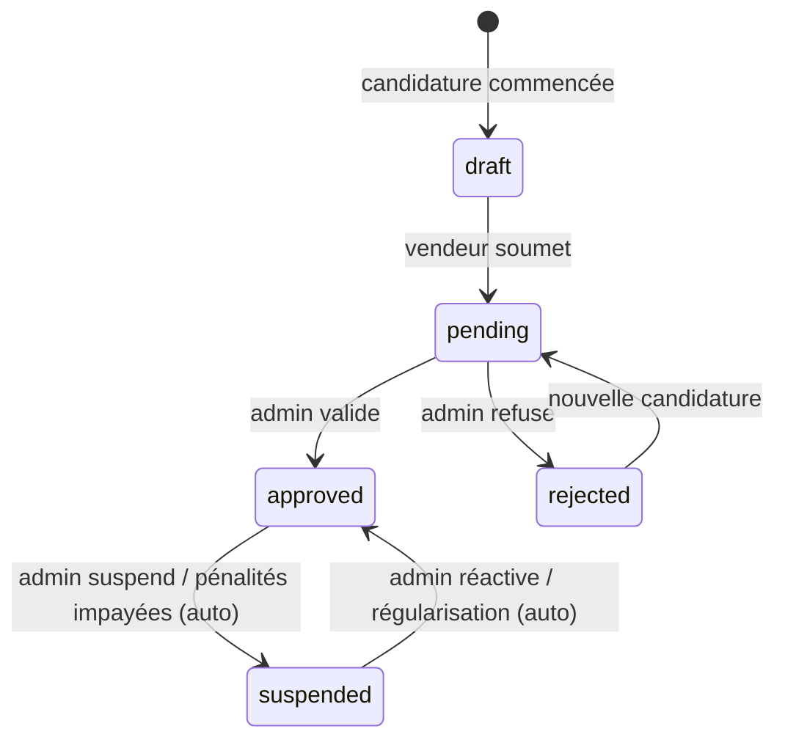
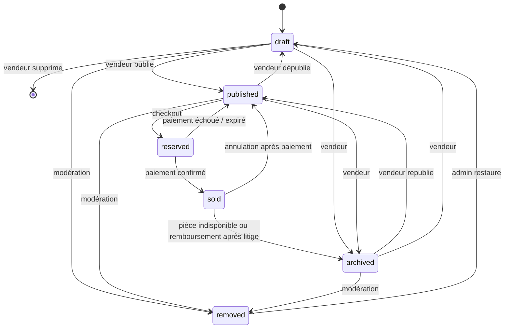
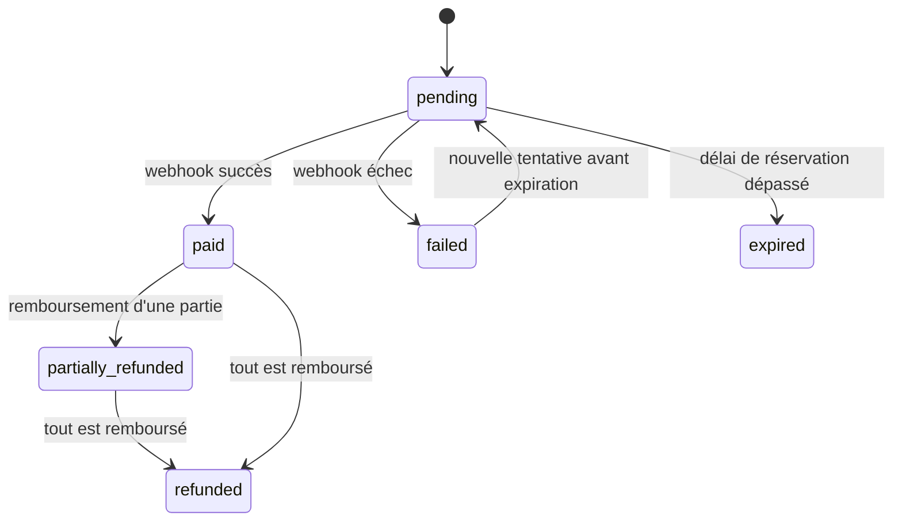
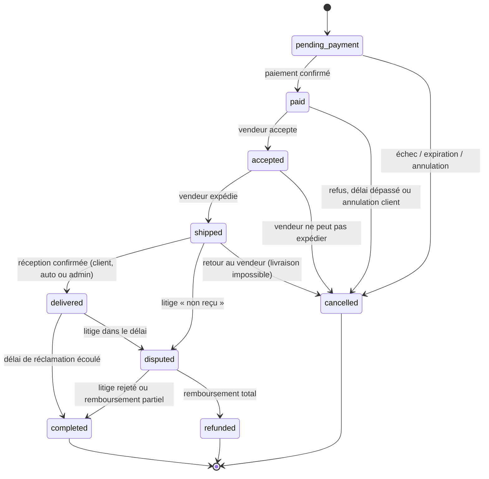
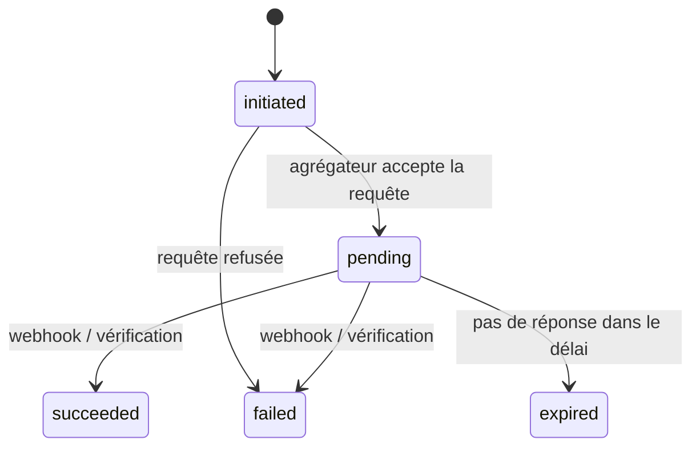
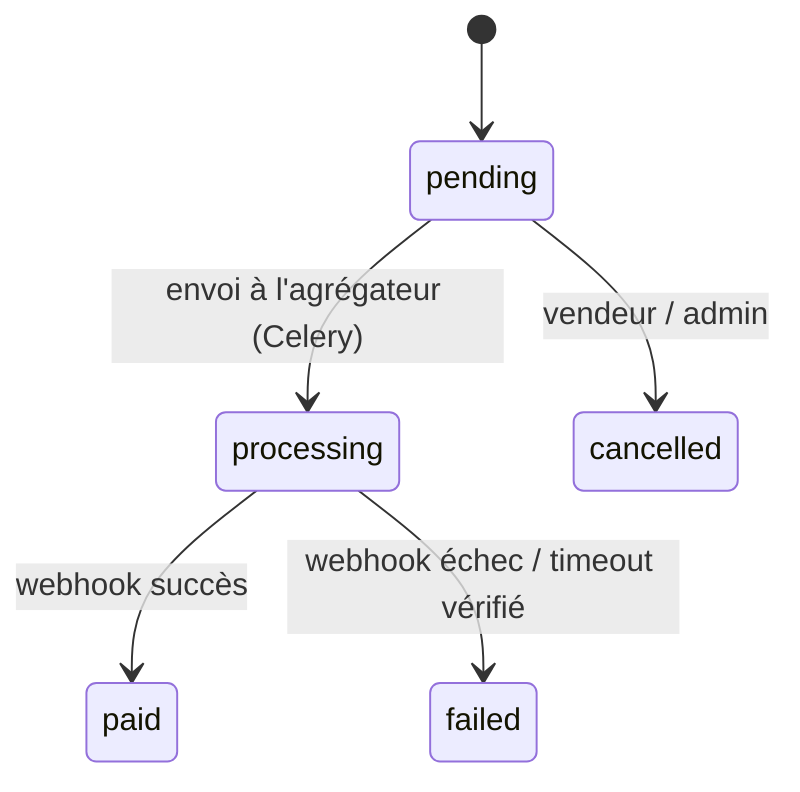
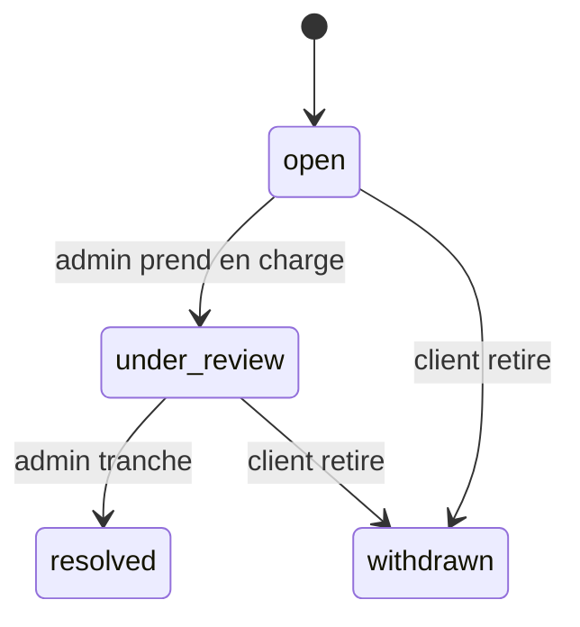
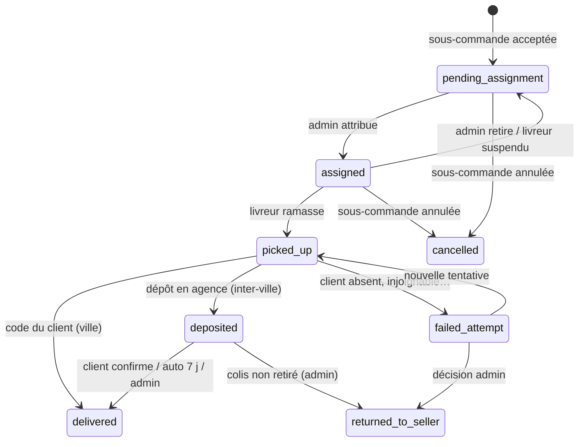

# 🧩 ERD — Modèle de données & machines à états (FripShop API)

> Livrable **P0-3**. Référence pour l'implémentation des phases 1 → 12.
> Les noms de modèles et de champs sont en **anglais** (code), les explications en **français**.
> Tout ce qui est marqué **⚠️ à valider** dépend d'une règle métier encore ouverte (voir § 8).
> Délais et règles produit alignés sur `USER_STORIES.md`, qui fait foi (mise à jour du 2026-10-19).
> Mise à jour du 2026-10-20 : **règles métier tranchées** (P0-5) : commission 10 % sur les articles, frais de reversement à la charge de FripShop, pénalités vendeur (`Penalty`, § 5.4), KYC, causes de remboursement.
> Mise à jour du 2026-10-20 : **livraison assurée par FripShop** (`Courier`, `Delivery` remplace `Shipment`, § 3.9 et § 4.8) ; frais de livraison au profit de FripShop.

---

## 1. Conventions communes

| Règle | Application |
|---|---|
| Héritage | Tous les modèles héritent de `core.TimeStampedModel` (`created_at`, `updated_at`). |
| Identifiant public | Tout modèle exposé dans l'API a un `public_id` (UUID v4, unique, indexé) via `core.UUIDModel`. L'`id` entier reste interne. |
| Argent | Deux champs : `<nom>_amount` `DecimalField(12, 2)` + `<nom>_currency` `CharField(3, default="XAF")`. Les montants XAF sont **entiers en pratique** (pas de centimes) : validation `amount == amount.to_integral_value()` dans les services. |
| Choix | `models.TextChoices` (valeurs en anglais, libellés en français via `gettext_lazy`). |
| Suppression | `PROTECT` sur tout ce qui touche à l'argent ou aux commandes. Pas de suppression physique d'une annonce vendue, d'une commande, d'une transaction ou d'une écriture du registre. |
| Statuts | Tout champ `status` soumis à une machine à états (§ 4) n'est **jamais** modifié directement : uniquement via le service de transition de l'app. |
| Téléphones | Format E.164 (`+2376XXXXXXXX`), validé et normalisé dans les services. |

Notation des tableaux : **PK** clé primaire, **FK** clé étrangère, **U** unique, **IDX** indexé, **N** nullable.

---

## 2. Vue d'ensemble

**Hiérarchie de commande :** un paiement = un `Order` → un `SellerOrder` par vendeur → des `OrderItem` (snapshots).
**Argent vendeur :** jamais de champ « solde » ; le solde est la **somme des `LedgerEntry`** (§ 5).

---

## 3. Modèles par app

### 3.1 `core`

**`City`** — référentiel des villes (adresses, boutiques, tarifs de livraison, filtres).

| Champ | Type | Contraintes / notes |
|---|---|---|
| id | BigAutoField | PK |
| name | Char(100) | « Douala », « Yaoundé »… |
| slug | Slug | U |
| region | Char(50) | Littoral, Centre… (10 régions) |
| is_active | Bool | défaut `True` |
| is_served | Bool | ouverte aux vendeurs (Douala, Yaoundé au lancement) |

> Placée dans `core` car utilisée par `accounts`, `sellers` et `shipping` (évite une dépendance `accounts → shipping`).

**`AuditLog`** — journal immuable des actions sensibles (US-A-11).

| Champ | Type | Contraintes / notes |
|---|---|---|
| actor | FK User | N, SET_NULL (`NULL` = système) |
| action | Choice | `seller_approved`, `seller_rejected`, `seller_suspended`, `seller_reactivated`, `listing_removed`, `refund_issued`, `dispute_resolved`, `payout_requested`, `payout_retried`, `payout_phone_changed`, `ledger_adjustment` |
| target_type / target_id | Char(50) / UUID | objet visé, par son `public_id` (pas de `GenericForeignKey` : plus simple à indexer et à lire) |
| data | JSON | contexte (motif, montants…), sans secret |
| ip_address | GenericIPAddress | N |
| | | IDX (`target_type`, `target_id`), (`actor`, `created_at`) |

Immuable comme `LedgerEntry`. Écrit par les **services**, jamais par les vues.

**`IdempotencyRecord`** — rejeu sûr des `POST` sensibles (`API.md` § 1.4 : checkout, nouvelle tentative de paiement, demande de reversement, paiement d'une pénalité).

| Champ | Type | Contraintes / notes |
|---|---|---|
| key | UUID | en-tête `Idempotency-Key` |
| user | FK User | CASCADE |
| endpoint | Char(100) | nom de la route |
| request_hash | Char(64) | SHA-256 du corps : même clé + corps différent → 409 `idempotency_key_reused` |
| response_status / response_body | PositiveSmallInt / JSON | réponse d'origine, renvoyée telle quelle |
| expires_at | DateTime | IDX — création + 24 h ; purge quotidienne (`core.purge_idempotency_records`) |
| | | U (`user`, `key`) |

### 3.2 `accounts`

**`User`** (custom, login par email — `AbstractBaseUser` + `PermissionsMixin`)

| Champ | Type | Contraintes / notes |
|---|---|---|
| id | BigAutoField | PK |
| public_id | UUID | U |
| email | Email | U (normalisé en minuscules, `Lower` + contrainte unique) |
| password | Char | hash Django |
| first_name, last_name | Char(100) | |
| phone | Char(20) | N, E.164 |
| email_verified_at | DateTime | N — `NULL` = non vérifié |
| phone_verified_at | DateTime | N (si OTP SMS retenu) |
| is_active, is_staff | Bool | |
| last_login | DateTime | N |

**`Address`** — carnet d'adresses.

| Champ | Type | Contraintes / notes |
|---|---|---|
| public_id | UUID | U |
| user | FK User | CASCADE, IDX |
| label | Char(50) | « Maison », « Bureau » |
| recipient_name | Char(150) | |
| phone | Char(20) | E.164 |
| city | FK City | PROTECT |
| neighborhood | Char(100) | quartier (Bonamoussadi, Akwa…) |
| landmark | Char(255) | repère (« face pharmacie X ») |
| details | Text | N |
| is_default | Bool | **une seule par user** : `UniqueConstraint(fields=["user"], condition=Q(is_default=True))` |

**`OneTimeCode`** — OTP de vérification et de réinitialisation.

| Champ | Type | Contraintes / notes |
|---|---|---|
| user | FK User | CASCADE |
| purpose | Choice | `email_verification`, `phone_verification`, `password_reset`, `payout_phone_change` |
| channel | Choice | `email`, `sms` |
| code_hash | Char(128) | **jamais le code en clair** |
| expires_at | DateTime | ~10 min |
| attempts | PositiveSmallInt | blocage après 5 essais |
| consumed_at | DateTime | N |
| | | IDX (`user`, `purpose`, `consumed_at`) |

### 3.3 `sellers`

**`Seller`** — la boutique (un `User` qui possède un `Seller`).

| Champ | Type | Contraintes / notes |
|---|---|---|
| public_id | UUID | U |
| user | OneToOne User | PROTECT |
| shop_name | Char(100) | |
| slug | Slug | U (URL publique de la boutique) |
| description | Text | N |
| logo | Image | N, stockage public |
| city | FK City | PROTECT, IDX — sert au filtre « ville » des annonces |
| contact_phone | Char(20) | |
| pickup_neighborhood, pickup_landmark | Char(100) / Char(255) | point de ramassage des colis (dans `city`) |
| pickup_phone | Char(20) | E.164 — appelé par le livreur |
| payout_provider | Choice | `mtn_momo`, `orange_money` |
| payout_phone | Char(20) | E.164 — **changement protégé par OTP** (voir note) |
| payout_account_name | Char(150) | nom du titulaire Mobile Money |
| status | Choice | `draft`, `pending`, `approved`, `rejected`, `suspended` — machine à états § 4.1, IDX |
| submitted_at | DateTime | N |
| reviewed_at | DateTime | N |
| reviewed_by | FK User | N, SET_NULL (admin) |
| rejection_reason | Text | N |
| suspension_reason_code | Choice | N — `admin`, `unpaid_penalties` (seule cette dernière est levée automatiquement) |
| suspension_reason | Text | N |
| commission_rate | Decimal(5, 4) | N — surcharge du taux par défaut (`settings.FRIPSHOP_COMMISSION_RATE = 0.10`, sur les articles seuls) |
| terms_accepted_at / terms_version | DateTime / Char(20) | acceptation des **CGU vendeur** (clause de pénalités) à la candidature |
| payout_hold_until | DateTime | N — reversements bloqués jusqu'à cette date (changement de numéro, US-S-05) |

> **Sécurité :** un changement de `payout_phone` exige le mot de passe et un OTP, puis fixe `payout_hold_until = now + 48 h`. C'est le vecteur de fraude classique en cas de compte volé.

**`SellerDocument`** — pièces KYC.

| Champ | Type | Contraintes / notes |
|---|---|---|
| public_id | UUID | U |
| seller | FK Seller | CASCADE |
| doc_type | Choice | `id_card`, `passport`, `selfie`, `rccm`, `patente`, `niu`, `other` — exigés : (`id_card` ou `passport`) + `selfie` + au moins un de `rccm`, `patente`, `niu` (vérifié au passage en `pending`) |
| file | File | **stockage privé**, URL signée à durée courte, admin uniquement |
| note | Char(255) | N |

### 3.4 `catalog`

**`Category`** — arbre `treebeard.MP_Node` (materialized path).

| Champ | Type | Contraintes / notes |
|---|---|---|
| name | Char(100) | |
| slug | Slug | U |
| size_system | Choice | `none`, `clothing_alpha` (XS…XXL), `clothing_numeric` (36…54), `shoes_eu` (35…47), `kids_age` — guide les tailles proposées |
| is_active | Bool | |

Racines : Vêtements, Chaussures, Sacs et accessoires, Maison.

**`Brand`** — `name`, `slug` (U), `is_active`. Facultative sur une annonce.

**`Listing`** — une pièce (quantité 1 par défaut).

| Champ | Type | Contraintes / notes |
|---|---|---|
| public_id | UUID | U |
| seller | FK Seller | PROTECT, IDX |
| category | FK Category | PROTECT, IDX |
| brand | FK Brand | N, SET_NULL |
| title | Char(120) | |
| slug | Slug | non unique, décoratif : l'URL est `/listings/<public_id>/` (US-V-05) |
| description | Text | |
| measurements | JSON | N — mensurations en cm (`{"chest": 52, "length": 70}`) ; clés validées par le service selon la catégorie |
| price_amount / price_currency | Decimal(12, 2) / Char(3) | `CheckConstraint(price_amount > 0)` |
| size | Char(20) | N, valeur cohérente avec `category.size_system` |
| condition | Choice | `A` comme neuf · `B` bon état, traces légères · `C` état correct, défauts signalés |
| gender | Choice | `women`, `men`, `unisex`, `kids` |
| color | Choice | liste fermée (filtrable) |
| quantity | PositiveSmallInt | défaut 1 — **unités encore disponibles** |
| status | Choice | machine à états § 4.2, IDX |
| published_at | DateTime | N |
| sold_at | DateTime | N |
| removed_reason | Text | N (modération) |
| removed_by | FK User | N, SET_NULL |
| search_vector | SearchVectorField | N, index **GIN** ; configuration de recherche `french_unaccent` (extension `unaccent`, créée par migration) ; mis à jour par le service (titre poids A, marque et catégorie B, description C) |

Index : (`status`, `published_at`), (`status`, `category`), (`status`, `price_amount`).
Filtre « ville » : jointure `seller__city` (pas de dénormalisation au MVP).

**`ListingImage`**

| Champ | Type | Contraintes / notes |
|---|---|---|
| public_id | UUID | U |
| listing | FK Listing | CASCADE |
| image | Image | original compressé (Celery) |
| thumbnail | Image | N, généré par Celery |
| position | PositiveSmallInt | U (`listing`, `position`) |
| is_primary | Bool | une seule par annonce : `UniqueConstraint(fields=["listing"], condition=Q(is_primary=True))` |

Maximum 8 images par annonce (vérifié dans le service).

### 3.5 `cart`

**`Cart`**

| Champ | Type | Contraintes / notes |
|---|---|---|
| public_id | UUID | U |
| token | UUID | U — valeur de l'en-tête `X-Cart-Token` (panier invité) |
| user | FK User | N, CASCADE ; un seul panier actif par user : `UniqueConstraint(fields=["user"], condition=Q(status="active"))` |
| status | Choice | `active`, `merged` (fusionné au login), `converted` (devenu commande) |
| last_activity_at | DateTime | purge des paniers invités inactifs (Celery Beat, 30 j) |

**`CartItem`** — `cart` (FK CASCADE), `listing` (FK CASCADE), `quantity` (défaut 1). U (`cart`, `listing`).
Le prix n'est **pas** stocké : le panier affiche toujours le prix courant ; le snapshot se fait au checkout.

### 3.6 `orders`

**`OrderSequence`** — numérotation lisible sans trou ni doublon.

| Champ | Type | Contraintes / notes |
|---|---|---|
| year | PositiveSmallInt | PK |
| last_value | PositiveInt | incrémenté sous `select_for_update()` |

**`Order`** — un paiement.

| Champ | Type | Contraintes / notes |
|---|---|---|
| public_id | UUID | U |
| number | Char(20) | U — `CMD-2026-000152` |
| buyer | FK User | PROTECT, IDX |
| payment_method | Choice | `mobile_money` (MVP), `cash_on_delivery` (option) |
| payment_status | Choice | machine à états § 4.3 |
| items_total_amount | Decimal(12, 2) | somme des sous-totaux articles |
| shipping_total_amount | Decimal(12, 2) | |
| total_amount / currency | Decimal(12, 2) / Char(3) | `CheckConstraint(total = items + shipping)` |
| expires_at | DateTime | fin de la réservation si impayée, IDX |
| paid_at | DateTime | N |
| shipping_address | FK Address | N, SET_NULL — **référence seulement** |
| ship_recipient_name, ship_phone, ship_city_name, ship_neighborhood, ship_landmark, ship_details | Char/Text | **snapshot** de l'adresse au checkout |
| ship_city | FK City | PROTECT — utile aux stats et aux tarifs |

> Pas de champ `status` global : l'état d'une commande se lit sur ses `SellerOrder` (règle 7 de `CLAUDE.md`). Le selector expose un statut **calculé** pour l'historique client.

**`SellerOrder`** — la part d'un vendeur.

| Champ | Type | Contraintes / notes |
|---|---|---|
| public_id | UUID | U |
| order | FK Order | PROTECT |
| seller | FK Seller | PROTECT, IDX |
| suffix | Char(2) | `A`, `B`… — U (`order`, `suffix`) |
| number | Char(24) | U — `CMD-2026-000152-A` |
| status | Choice | machine à états § 4.4, IDX (`seller`, `status`) |
| seller_shop_name | Char(100) | **snapshot** |
| items_subtotal_amount | Decimal(12, 2) | |
| shipping_method | Choice | `courier` (intra-ville), `agency` (inter-ville) |
| shipping_fee_amount | Decimal(12, 2) | snapshot du tarif ; **revenu FripShop**, jamais crédité au vendeur |
| commission_rate | Decimal(5, 4) | **snapshot** du taux au moment du paiement |
| commission_amount | Decimal(12, 2) | `items_subtotal × commission_rate`, arrondi à l'unité XAF ; jamais sur la livraison |
| seller_net_amount | Decimal(12, 2) | `items_subtotal − commission` : ce qui sera crédité au vendeur |
| currency | Char(3) | |
| accept_deadline_at | DateTime | N — fixé au passage à `paid` |
| delivered_at | DateTime | N |
| funds_release_at | DateTime | N — `delivered_at + délai de réclamation`, IDX |
| completed_at | DateTime | N |
| cancelled_at | DateTime | N |
| cancel_reason | Choice | N — `payment_failed`, `payment_expired`, `buyer_cancelled`, `seller_item_unavailable`, `seller_item_damaged`, `seller_refused_other`, `seller_timeout`, `delivery_failed`, `admin` |

**`OrderItem`** — snapshot d'une annonce achetée.

| Champ | Type | Contraintes / notes |
|---|---|---|
| public_id | UUID | U |
| seller_order | FK SellerOrder | PROTECT |
| listing | FK Listing | PROTECT (référence ; l'annonce n'est jamais supprimée physiquement) |
| listing_public_id | UUID | snapshot de la référence |
| title | Char(120) | snapshot |
| condition, size, brand_name | Char | snapshot |
| image_url | URL | N, snapshot de l'image principale |
| unit_price_amount | Decimal(12, 2) | snapshot |
| quantity | PositiveSmallInt | |
| line_total_amount | Decimal(12, 2) | `CheckConstraint(line_total = unit_price × quantity)` |

**`SellerOrderStatusChange`** — historique immuable des transitions.

| Champ | Type | Contraintes / notes |
|---|---|---|
| seller_order | FK SellerOrder | CASCADE, IDX |
| from_status / to_status | Choice | |
| actor | FK User | N, SET_NULL (`NULL` = système) |
| actor_role | Choice | `buyer`, `seller`, `admin`, `system` |
| note | Text | N |

### 3.7 `payments`

**`Transaction`** — tout mouvement d'argent avec l'agrégateur côté acheteur.

| Champ | Type | Contraintes / notes |
|---|---|---|
| public_id | UUID | U |
| kind | Choice | `charge`, `refund`, `penalty_charge` (paiement d'une pénalité par le vendeur) |
| order | FK Order | N, PROTECT, IDX — obligatoire pour `charge` et `refund` |
| penalty | FK Penalty | N, PROTECT — obligatoire pour `penalty_charge` ; `CheckConstraint` : exactement l'un de `order` / `penalty` |
| seller_order | FK SellerOrder | N, PROTECT — renseigné pour un remboursement (avec Campay, un remboursement est un `withdraw` vers `payer_phone`) |
| provider | Choice | `campay` au MVP (ADR 0004) ; d'autres valeurs s'ajoutent avec un nouvel adaptateur |
| channel | Choice | `mtn_momo`, `orange_money` |
| provider_reference | Char(100) | N — U (`provider`, `provider_reference`) |
| idempotency_key | UUID | U — envoyée à l'agrégateur |
| amount / currency | Decimal(12, 2) / Char(3) | |
| payer_phone | Char(20) | N |
| status | Choice | machine à états § 4.5 |
| failure_code / failure_message | Char / Text | N |
| request_payload / last_response | JSON | audit (sans secret) |
| completed_at | DateTime | N |

**`WebhookEvent`** — journal et **idempotence** des webhooks (paiements **et** reversements).

| Champ | Type | Contraintes / notes |
|---|---|---|
| provider | Choice | |
| event_id | Char(150) | U (`provider`, `event_id`) — un rejeu est ignoré |
| event_type | Char(100) | |
| payload | JSON | brut |
| signature_valid | Bool | un webhook invalide est stocké puis rejeté |
| processed_at | DateTime | N |
| processing_error | Text | N |

### 3.8 `payouts`

**`LedgerEntry`** — registre **immuable** du solde vendeur (détail § 5).

| Champ | Type | Contraintes / notes |
|---|---|---|
| public_id | UUID | U |
| seller | FK Seller | PROTECT, IDX (`seller`, `account`) |
| account | Choice | `pending`, `available`, `in_transit`, `paid_out` |
| entry_type | Choice | `sale`, `commission`, `release`, `refund`, `payout`, `payout_settled`, `payout_reversal`, `penalty`, `adjustment` |
| amount / currency | Decimal(12, 2) **signé** / Char(3) | crédit > 0, débit < 0 |
| group_id | UUID | relie les écritures d'un même mouvement (un transfert entre comptes somme à 0) |
| idempotency_key | Char(150) | **U** — ex. `so:<id>:sale` ; empêche un double crédit sur rejeu de webhook |
| seller_order | FK SellerOrder | N, PROTECT |
| payout | FK Payout | N, PROTECT |
| dispute | FK Dispute | N, PROTECT |
| penalty | FK Penalty | N, PROTECT |
| description | Char(255) | |
| created_by | FK User | N, SET_NULL (obligatoire pour `adjustment`) |

Immuabilité : `save()` refuse toute mise à jour, `delete()` lève une exception, pas d'édition dans l'admin. Une erreur se corrige par une écriture inverse (`adjustment`).

**`Penalty`** — pénalité due par un vendeur à FripShop (décision du 2026-10-20, US-S-35, US-A-15, US-Y-08).

| Champ | Type | Contraintes / notes |
|---|---|---|
| public_id | UUID | U |
| seller | FK Seller | PROTECT, IDX (`seller`, `status`) |
| seller_order | FK SellerOrder | PROTECT — une pénalité par sous-commande : U (`seller_order`) |
| reason | Choice | `dispute_seller_fault`, `return_seller_fault` |
| amount / currency | Decimal(12, 2) / Char(3) | = `SellerOrder.shipping_fee_amount` ; `CheckConstraint(amount > 0)` |
| status | Choice | `unpaid`, `paid`, `waived` |
| settled_by | Choice | N — `balance` (déduite du solde), `mobile_money` (payée par le vendeur), `admin` |
| settled_at | DateTime | N |
| created_by | FK User | PROTECT (admin) |
| waived_by / waive_reason | FK User N / Text N | annulation motivée |

**`Payout`** — reversement Mobile Money.

| Champ | Type | Contraintes / notes |
|---|---|---|
| public_id | UUID | U |
| seller | FK Seller | PROTECT, IDX |
| amount / currency | Decimal(12, 2) / Char(3) | `CheckConstraint(amount > 0)` ; minimum `PAYOUT_MIN_AMOUNT` (5 000 XAF) vérifié **dans le service** : un réglage modifiable ne doit pas être figé dans une contrainte de base de données |
| fee_amount | Decimal(12, 2) | frais réels de l'agrégateur (Campay : 1 %) ; **à la charge de FripShop** : le vendeur reçoit `amount` en entier, rien n'est écrit au registre du vendeur |
| provider / channel | Choice | |
| destination_phone, destination_name | Char | **snapshot** des infos de reversement |
| provider_reference | Char(100) | N — U (`provider`, `provider_reference`) |
| idempotency_key | UUID | U |
| status | Choice | `pending`, `processing`, `paid`, `failed`, `cancelled` (§ 4.6) ; **une seule demande en cours par vendeur** : `UniqueConstraint(fields=["seller"], condition=Q(status__in=["pending", "processing"]))` |
| requested_by | FK User | N (vendeur ou admin ; `NULL` = automatique) |
| processed_at | DateTime | N |
| failure_message | Text | N |

### 3.9 `shipping` — tarifs, livreurs, livraisons

> **Décision du 2026-10-20 :** la livraison est assurée par **FripShop**, avec ses propres livreurs. Le vendeur ne voit jamais les coordonnées du client. Les frais de livraison reviennent à FripShop (les livreurs sont payés hors plateforme).

**`ShippingRate`**

| Champ | Type | Contraintes / notes |
|---|---|---|
| origin_city | FK City | PROTECT |
| destination_city | FK City | PROTECT — égale à `origin_city` pour l'intra-ville |
| method | Choice | `courier` (intra-ville : un livreur ramasse et livre), `agency` (inter-ville : un livreur ramasse et dépose en agence de voyage) |
| price_amount / currency | Decimal(12, 2) / Char(3) | |
| estimated_days_min / max | PositiveSmallInt | |
| is_active | Bool | |
| | | U (`origin_city`, `destination_city`, `method`) |

**`Courier`** — le profil livreur, attribué par l'admin (US-A-13).

| Champ | Type | Contraintes / notes |
|---|---|---|
| public_id | UUID | U |
| user | OneToOne User | PROTECT — compte client existant, email vérifié |
| city | FK City | PROTECT, IDX — ville de rattachement |
| phone | Char(20) | E.164, communiqué au vendeur et au client pendant la livraison |
| status | Choice | `active`, `suspended`, IDX |
| activated_by | FK User | N, SET_NULL (admin) |
| suspension_reason | Text | N |

**`Delivery`** — remplace `Shipment` : la partie physique d'une sous-commande.

| Champ | Type | Contraintes / notes |
|---|---|---|
| public_id | UUID | U |
| seller_order | OneToOne SellerOrder | PROTECT — créée au passage de la sous-commande en `accepted` |
| method | Choice | snapshot de `SellerOrder.shipping_method` (`courier`, `agency`) |
| status | Choice | machine à états § 4.8, IDX (`courier`, `status`) |
| courier | FK Courier | N, PROTECT, IDX |
| assigned_by | FK User | N, SET_NULL (admin) |
| assigned_at, picked_up_at, deposited_at, delivered_at, returned_at | DateTime | N |
| pickup_* | Char / Text | **snapshot** du point de ramassage du vendeur (ville, quartier, repère, téléphone) |
| confirmation_code | Char(4) | code donné par le client au livreur (voir note) |
| code_attempts | PositiveSmallInt | blocage après `DELIVERY_CODE_MAX_ATTEMPTS` |
| failed_attempts | PositiveSmallInt | nombre de passages en `failed_attempt` |
| agency_name | Char(100) | N — **obligatoire** pour passer en `deposited` |
| waybill_number | Char(100) | N — n° de bordereau, **obligatoire** pour `deposited` |
| auto_confirm_at | DateTime | N, IDX — `deposited_at + AUTO_CONFIRM_DELIVERY` (agence uniquement) |
| delivery_confirmed_by | Choice | N — `courier_code`, `buyer`, `system`, `admin` |
| return_fault | Choice | N — **obligatoire** pour `returned_to_seller` : `buyer`, `seller`, `fripshop` (fixe le remboursement, § 4.8) |

> **Pourquoi le code n'est pas haché :** contrairement à un OTP d'authentification, le client doit pouvoir **le relire** dans l'app au moment de la remise. Un code à 4 chiffres haché se retrouverait de toute façon par force brute (10 000 valeurs). La protection vient de la **limite d'essais** côté livreur et du fait que le code n'est renvoyé **qu'à l'acheteur** (jamais au vendeur ni au livreur).

**`DeliveryStatusChange`** — historique immuable (`delivery`, `from_status`, `to_status`, `actor`, `actor_role` `courier`/`admin`/`buyer`/`system`, `note`, `failure_reason` N : `absent`, `unreachable`, `address_not_found`, `refused`). Il sert aussi à l'historique des courses du livreur (US-D-06).

**Visibilité des coordonnées du client** (snapshot `Order.ship_*`) :

| Qui | Ce qu'il voit |
|---|---|
| Vendeur | Ville de destination uniquement |
| Livreur attribué | Prénom, téléphone, quartier, repère, détails — **tant que la livraison n'est pas terminale** |
| Acheteur | Tout, plus le `confirmation_code` |
| Admin | Tout |

Les serializers de sortie sont **distincts par espace** (`/seller/…`, `/courier/…`, `/me/…`) : on ne masque pas des champs dans un serializer partagé, on n'expose que ce que chaque rôle a le droit de voir.

### 3.10 `disputes`

**`Dispute`** — un litige par sous-commande au MVP.

| Champ | Type | Contraintes / notes |
|---|---|---|
| public_id | UUID | U |
| seller_order | OneToOne SellerOrder | PROTECT |
| opened_by | FK User | PROTECT |
| reason | Choice | `not_received`, `not_as_described`, `damaged`, `wrong_item`, `other` |
| description | Text | |
| status | Choice | machine à états § 4.7 |
| seller_response_due_at | DateTime | ouverture + 72 h (US-S-40) ; passé ce délai, l'admin tranche sur les éléments disponibles |
| outcome | Choice | N — `full_refund`, `partial_refund`, `rejected` |
| fault | Choice | N — obligatoire à la résolution : `seller`, `fripshop`, `buyer`, `none` ; `full_refund` + `seller` → `Penalty` |
| refund_amount | Decimal(12, 2) | N — `CheckConstraint(refund_amount <= total de la sous-commande)` |
| resolution_note | Text | N |
| resolved_by | FK User | N, SET_NULL |
| resolved_at | DateTime | N |

**`DisputeMessage`** — `dispute` (FK CASCADE), `author` (FK User), `author_role` (`buyer`, `seller`, `admin`), `body`.
**`DisputeAttachment`** — `dispute` (FK CASCADE), `message` (FK N), `file` (stockage **privé**), `uploaded_by`.

### 3.11 `notifications`

**`DeviceToken`** — `user` (FK CASCADE), `token` (U), `platform` (`android`, `ios`, `web`), `is_active`, `last_seen_at`. Un token invalide renvoyé par FCM est désactivé.

### 3.12 Post-MVP (non détaillé)

`reviews.SellerReview` (lié à un `SellerOrder` `completed`, un avis par sous-commande), `promotions.Coupon`, favoris, suivi de boutiques, offres. Ils s'accrochent à `SellerOrder`, `Listing` et `Seller` sans modifier le schéma ci-dessus.

---

## 4. Machines à états

Chaque machine est implémentée par un dictionnaire `ALLOWED_TRANSITIONS` et **un service de transition unique** par modèle (ex. `seller_order_transition(*, seller_order, to_status, actor, note)`), qui :
1. verrouille la ligne (`select_for_update()`) ;
2. vérifie la transition et ses gardes, sinon lève `InvalidTransitionError` (HTTP 409) ;
3. applique les effets dans la **même transaction** ;
4. planifie les notifications avec `transaction.on_commit()`.

### 4.1 `Seller.status`

| Transition | Acteur | Gardes | Effets |
|---|---|---|---|
| → `draft` | vendeur | email vérifié ; pas déjà de `Seller` | boutique créée, non visible ; dépôt des pièces possible |
| `draft → pending` | vendeur | champs obligatoires + pièces KYC requises + CGU acceptées | `submitted_at` ; notif admin |
| `pending → approved` | admin | — | `reviewed_at/by` ; notif vendeur ; peut publier |
| `pending → rejected` | admin | motif obligatoire | notif vendeur avec motif |
| `rejected → pending` | vendeur | pièces mises à jour | |
| `approved → suspended` | admin | motif obligatoire | annonces masquées (filtre `seller__status=approved` dans les selectors, **sans** modifier les annonces) ; sous-commandes en cours traitées au cas par cas ; reversements bloqués |
| `suspended → approved` | admin | — | annonces de nouveau visibles |
| `approved → suspended` (auto) | système | plus de `PENALTY_FREEZE_THRESHOLD` pénalités `unpaid` | `suspension_reason_code = unpaid_penalties` ; mise en demeure ; `AuditLog` |
| `suspended → approved` (auto) | système | `suspension_reason_code = unpaid_penalties` et impayées ≤ seuil | notif vendeur ; `AuditLog` |

### 4.2 `Listing.status`

| Transition | Acteur | Gardes | Effets |
|---|---|---|---|
| `draft → published` | vendeur | vendeur `approved` ; ≥ 1 image ; titre, catégorie, prix, état renseignés ; taille si `size_system ≠ none` | `published_at` ; `search_vector` |
| `published → draft` | vendeur | — | disparaît du catalogue ; marquée indisponible dans les paniers |
| `published → reserved` | système | `quantity` passe à 0 | voir règle multi-quantité |
| `reserved → published` | système | `Order` expiré / échoué / annulé | `quantity` restaurée |
| `reserved → sold` | système | paiement confirmé, plus aucune réservation en attente | `sold_at` |
| `sold → published` | système | sous-commande `cancelled` après paiement : annulation client, délai d'acceptation dépassé, refus vendeur `seller_refused_other` | `quantity` restaurée ; `sold_at` remis à `NULL` |
| `sold → archived` | système | refus vendeur `seller_item_unavailable` / `seller_item_damaged`, ou sous-commande `refunded` après litige | `quantity` restaurée ; le vendeur republie quand il a la pièce en main |
| `* → archived` | vendeur | pas `reserved`, pas `sold` | |
| `archived → published` | vendeur | mêmes gardes que `draft → published` | `published_at` |
| `draft →` supprimée | vendeur | jamais commandée | suppression physique (US-S-17) ; les autres statuts s'archivent |
| `* → removed` | admin | pas `reserved`, pas `sold` ; motif obligatoire | notif vendeur |
| `removed → draft` | admin | — | |

**Règle multi-quantité :** `quantity` = unités encore disponibles. La réservation la décrémente sous `select_for_update()`. Le statut suit : `quantity > 0` → `published` ; `quantity = 0` avec une commande en attente de paiement → `reserved` ; `quantity = 0` sans attente → `sold`.
**Édition :** autorisée en `draft`, `published` et `archived` uniquement. Un changement de prix n'affecte pas les commandes déjà créées (snapshot).

### 4.3 `Order.payment_status`

| Transition | Effets |
|---|---|
| `pending → paid` | toutes les `SellerOrder` passent `pending_payment → paid` ; annonces `reserved → sold` ; écritures du registre (§ 5) |
| `pending → failed` | l'acheteur peut relancer un paiement tant que `expires_at` n'est pas atteint (nouvelle `Transaction`) |
| `pending/failed → expired` | **avant d'expirer**, la tâche interroge l'agrégateur (statut réel de la dernière transaction) ; puis `SellerOrder → cancelled`, annonces libérées |
| `paid → partially_refunded / refunded` | calculé à partir des `Transaction` de type `refund` réussies |

> **Paiement tardif — décidé le 2026-10-19** (webhook de succès reçu après expiration, fréquent avec Mobile Money) : si toutes les annonces sont encore disponibles, on les re-réserve et la commande passe `paid` ; sinon, remboursement automatique et notification de l'acheteur.

### 4.4 `SellerOrder.status` — machine centrale

| De → Vers | Déclencheur | Acteur | Gardes | Effets |
|---|---|---|---|---|
| `pending_payment → paid` | webhook de paiement réussi | système | `Order.payment_status = paid` | annonces `sold` ; registre : `sale`, `commission` sur `pending` (les frais de livraison restent à FripShop) ; `accept_deadline_at` ; notif vendeur (push + email) |
| `pending_payment → cancelled` | échec, expiration, annulation client | système / client | — | annonces → `published` ; aucune écriture au registre |
| `paid → accepted` | le vendeur accepte | vendeur (propriétaire) | `now < accept_deadline_at` | `Delivery` créée en `pending_assignment` (§ 4.8) ; code de livraison envoyé au client ; notif client et admin |
| `paid → cancelled` | refus du vendeur, délai d'acceptation dépassé, annulation client | vendeur / système / client | — | `Transaction` `refund` ; registre : `refund` (annule les écritures `pending`) ; annonces → `published`, ou `archived` si le motif du refus est « pièce indisponible / abîmée » (§ 4.2) ; notifs |
| `accepted → shipped` | le livreur confirme le ramassage | système (via `Delivery → picked_up`) | — | notif client et vendeur |
| `accepted → cancelled` | le vendeur ne peut pas expédier | vendeur / admin | motif | comme `paid → cancelled` |
| `shipped → delivered` | `Delivery → delivered` : code saisi par le livreur (ville) ; confirmation du client ou automatique après `auto_confirm_at` (agence) ; admin | système (via `Delivery`) | — | `delivered_at`, `funds_release_at` ; notif vendeur |
| `shipped → cancelled` | `Delivery → returned_to_seller` | système (via `Delivery`) | décision admin | `Transaction` `refund` selon `Delivery.return_fault` (§ 4.8) ; registre : `refund` ; annonce → `published` |
| `shipped → disputed` | litige « non reçu » | client | délai minimal après `shipped_at` (⚠️) | `Dispute` créé ; fonds gelés (voir § 5) |
| `delivered → disputed` | litige | client | `now < funds_release_at` | idem |
| `delivered → completed` | délai de réclamation écoulé | système | aucun litige ouvert | registre : `release` (`pending → available`) ; règlement des pénalités impayées (§ 5.4) ; `completed_at` |
| `disputed → completed` | litige rejeté ou remboursement partiel | admin | `Dispute` résolu | si partiel : `Transaction` `refund` + écriture `refund` ; puis `release` du reste (et règlement des pénalités impayées, § 5.4) |
| `disputed → refunded` | remboursement total | admin | `Dispute` résolu en `full_refund` | `Transaction` `refund` de **100 %** (articles + livraison) ; registre : `refund` du total ; annonce → `archived` ; retour physique décidé par l'admin ; si `fault = seller` → `Penalty` (§ 5.4) |

**Terminaux :** `completed`, `cancelled`, `refunded`.
**Gel des fonds (décidé le 2026-10-19 : gel ciblé) :** aucune écriture spéciale, et le reste du solde (`available`) reste reversable. Les fonds restent sur `pending` tant que la sous-commande n'est pas `completed` ; la tâche de libération ne sélectionne que les `delivered` dont le délai est écoulé.
**Paiement à la livraison** (option) : nécessite un chemin distinct (`pending_payment` sauté, encaissement à la livraison, commission due par le vendeur). **Hors MVP** tant que la question « qui encaisse ? » n'est pas tranchée.

### 4.5 `Transaction.status`

Correspondance avec Campay (`PENDING`, `SUCCESSFUL`, `FAILED`) : ADR 0004 § 8.1 ; `expired` est un statut **local**. Le statut appliqué est toujours **relu par l'API** après un webhook, jamais pris dans le webhook. Seul un statut terminal (`succeeded`, `failed`, `expired`) déclenche des effets sur `Order` ou `SellerOrder`. Un webhook qui contredit un statut terminal est journalisé et signalé à l'admin, jamais appliqué automatiquement.

### 4.6 `Payout.status`

| Transition | Effets sur le registre |
|---|---|
| → `pending` | sous verrou du `Seller` : vendeur `approved`, `payout_hold_until` dépassé, aucune demande en cours, `amount ≥ PAYOUT_MIN_AMOUNT`, `available ≥ amount` ; `payout` : `available −X`, `in_transit +X` |
| `pending → cancelled` | `payout_reversal` : `in_transit −X`, `available +X` |
| `processing → paid` | `payout_settled` : `in_transit −X`, `paid_out +X` ; notif vendeur |
| `processing → failed` | `payout_reversal` : `in_transit −X`, `available +X` ; notif vendeur + admin |

Un `withdraw` qui expire sans réponse reste `processing` et part en rapprochement : **jamais de relance automatique** (risque de double paiement, ADR 0004 § 8.1). Si le **solde Campay de FripShop** sur l'opérateur du bénéficiaire est insuffisant (trésorerie, distincte du registre du vendeur), le `Payout` reste `pending` et l'admin est alerté. Un reversement échoué n'est jamais rejoué : la « relance » admin (US-A-07) crée un **nouveau** `Payout` (nouvelle clé d'idempotence), tracé dans `AuditLog`.

### 4.7 `Dispute.status`

| Transition | Effets |
|---|---|
| → `open` | `SellerOrder → disputed` ; notif vendeur et admin ; le vendeur répond par `DisputeMessage` |
| `open → under_review` | automatique à `seller_response_due_at` si l'admin ne l'a pas déjà pris en charge |
| `→ withdrawn` | `SellerOrder → delivered` si le délai n'est pas écoulé, sinon `→ completed` |
| `under_review → resolved` | `outcome` obligatoire ; `full_refund` → `SellerOrder refunded` ; `partial_refund` ou `rejected` → `SellerOrder completed` |

### 4.8 `Delivery.status`

| Transition | Acteur | Gardes | Effets |
|---|---|---|---|
| → `pending_assignment` | système | `SellerOrder → accepted` | snapshot du point de ramassage ; `confirmation_code` généré ; code envoyé à l'acheteur |
| `pending_assignment → assigned` | admin | livreur `active` de la ville de ramassage ; le livreur n'est **ni l'acheteur ni le vendeur** | `assigned_at`, `assigned_by` ; notif livreur et vendeur ; `AuditLog` |
| `assigned → pending_assignment` | admin / système | — | livreur retiré (ou suspendu) |
| `assigned → picked_up` | livreur attribué | — | `SellerOrder → shipped` ; notif client et vendeur |
| `picked_up → delivered` | livreur attribué | méthode `courier` ; code correct, `code_attempts < max` | `delivery_confirmed_by = courier_code` ; `SellerOrder → delivered` |
| `picked_up → deposited` | livreur attribué | méthode `agency` ; `agency_name` et `waybill_number` renseignés | `deposited_at`, `auto_confirm_at` ; notif client (agence, ville, bordereau) |
| `deposited → delivered` | client / système / admin | — | `SellerOrder → delivered` |
| `picked_up → failed_attempt` | livreur attribué | motif obligatoire | `failed_attempts + 1` ; notif client et admin |
| `failed_attempt → picked_up` | livreur / admin | `failed_attempts < DELIVERY_MAX_FAILED_ATTEMPTS` | nouvelle tentative |
| `failed_attempt / deposited → returned_to_seller` | admin, puis confirmation du livreur | — | `return_fault` obligatoire ; `SellerOrder → cancelled` (`cancel_reason = delivery_failed`) ; remboursement : `buyer` → **articles seulement** (FripShop garde la livraison), `seller` → **100 %** + `Penalty`, `fripshop` → **100 %** ; annonce → `published` (`archived` si `seller`) |
| `* → cancelled` | système | `SellerOrder → cancelled` avant le ramassage | — |

Un code faux incrémente `code_attempts`. Au-delà de `DELIVERY_CODE_MAX_ATTEMPTS`, la saisie est bloquée et l'admin est alerté (il peut valider la livraison lui-même après vérification).

---

## 5. Registre du solde vendeur

### 5.1 Comptes

| Compte | Sens |
|---|---|
| `pending` | gagné mais **non libéré** (commande pas encore terminée, ou litige en cours) |
| `available` | libéré, reversable |
| `in_transit` | reversement demandé, en cours chez l'agrégateur |
| `paid_out` | reversé avec succès (cumul) |

**Solde d'un compte** = `SUM(amount)` des écritures du vendeur sur ce compte (selector `seller_balance_get`, une requête agrégée).
**Invariant :** `pending ≥ 0`, `available ≥ 0`, `in_transit ≥ 0`, vérifié dans les services et par un test de propriété.

### 5.2 Exemple chiffré

Règles décidées le 2026-10-20 : commission 10 % sur les articles. Les frais de livraison reviennent à FripShop (décidé le 2026-10-20), ils n'apparaissent donc pas dans le registre du vendeur.
Sous-commande `CMD-2026-000152-A` : une veste à 15 000 XAF, livraison 1 500 XAF (payée par le client, gardée par FripShop).

| Étape | Écritures | pending | available | in_transit | paid_out |
|---|---|---|---|---|---|
| Paiement confirmé | `sale` +15 000, `commission` −1 500 (compte `pending`) | 13 500 | 0 | 0 | 0 |
| Délai de réclamation écoulé | `release` : `pending` −13 500, `available` +13 500 | 0 | 13 500 | 0 | 0 |
| Reversement demandé | `payout` : `available` −13 500, `in_transit` +13 500 | 0 | 0 | 13 500 | 0 |
| Reversement réussi | `payout_settled` : `in_transit` −13 500, `paid_out` +13 500 | 0 | 0 | 0 | 13 500 |

Variantes :
- **Annulation après paiement :** `refund` −13 500 sur `pending` → tout revient à 0 (le client est remboursé de 16 500 par une `Transaction` ; la part livraison et la commission ne passent pas par le registre du vendeur).
- **Remboursement partiel de 5 000 (litige) :** `refund` −5 000 sur `pending`, puis `release` de 8 500.
- **Reversement échoué :** `payout_reversal` remet 13 500 sur `available`.

### 5.3 Concurrence et idempotence

- Toute création de `Payout` verrouille la ligne `Seller` (`select_for_update()`) avant de calculer `available` : deux demandes simultanées ne peuvent pas dépenser le même solde.
- `LedgerEntry.idempotency_key` (unique) garantit qu'un webhook rejoué ne crédite pas deux fois (`so:<id>:sale`, `so:<id>:release:pending`, `payout:<id>:settled:paid_out`…).
- La commission de FripShop se lit sur `SellerOrder.commission_amount` (stats admin) ; un grand livre plateforme pourra être ajouté plus tard sans changer ce modèle.

### 5.4 Pénalités vendeur

**Règle :** une pénalité n'est créée **que par l'admin**, quand il attribue la cause d'un remboursement total au **vendeur** (litige ou retour). Son montant est égal aux frais de livraison payés par le client.

**Règlement :**
1. À la création, sous verrou du `Seller` : si `available ≥ amount`, écriture `penalty` (`available −X`) et `Penalty → paid` (`settled_by = balance`).
2. Sinon, `Penalty` reste `unpaid`. On ne prélève jamais plus que le disponible : l'invariant `available ≥ 0` tient.
3. À chaque `release` (§ 4.4, `delivered → completed`), dans la même transaction : les pénalités `unpaid` sont réglées, **de la plus ancienne à la plus récente**, tant que le disponible couvre leur montant entier.
4. Le vendeur peut aussi payer par Mobile Money : `Transaction(kind=penalty_charge)` ; au succès, `Penalty → paid` (`settled_by = mobile_money`), sans écriture au registre (l'argent ne transite pas par son solde).

**Gel :** après chaque création ou règlement, le service recompte les pénalités `unpaid`.
- `count > PENALTY_FREEZE_THRESHOLD` (3) et vendeur `approved` → `Seller → suspended` (`suspension_reason_code = unpaid_penalties`) + mise en demeure (email + notification, délai `PENALTY_NOTICE_DELAY`).
- `count ≤ seuil` et vendeur suspendu **pour ce motif** → `Seller → approved` automatiquement. Une suspension par l'admin n'est jamais levée automatiquement.

**Exemple :** une pénalité de 1 500 XAF, vendeur avec 1 000 XAF disponibles → `unpaid`. Il vend une pièce, 9 000 XAF sont libérés : `release` +9 000, puis `penalty` −1 500 → 8 500 disponibles, pénalité `paid`.

---

## 6. Délais et tâches planifiées (Celery Beat)

| Paramètre (`settings`) | Valeur (`USER_STORIES` § 8) | Utilisé par | Tâche |
|---|---|---|---|
| `RESERVATION_TTL` | 15 min | `Order.expires_at` | `orders.expire_unpaid_orders` (toutes les 5 min) — vérifie l'agrégateur avant d'expirer |
| `SELLER_ACCEPT_DEADLINE` | 24 h | `SellerOrder.accept_deadline_at` | `orders.cancel_unaccepted` (toutes les 15 min) |
| `SELLER_SHIP_REMINDER` | 72 h après acceptation | — | `orders.remind_unshipped` (alerte vendeur + admin, **pas** d'annulation automatique) |
| `AUTO_CONFIRM_DELIVERY` | 7 j après le dépôt en agence (inter-ville uniquement ; rappel au client avant) | `Delivery.auto_confirm_at` | `shipping.auto_confirm_deliveries` (toutes les heures) |
| `DELIVERY_CODE_MAX_ATTEMPTS` | 5 | `Delivery.code_attempts` | — |
| `DELIVERY_MAX_FAILED_ATTEMPTS` | 2 | `Delivery.failed_attempts` | `shipping.alert_unassigned_deliveries` (alerte admin si une livraison attend un livreur depuis plus de 4 h ⚠️) |
| `CLAIM_WINDOW` | 48 h après livraison | `SellerOrder.funds_release_at` | `payouts.release_funds` (toutes les heures) |
| `DISPUTE_SELLER_RESPONSE` | 72 h | `Dispute.seller_response_due_at` | `disputes.escalate_unanswered` (toutes les heures) |
| `PAYOUT_MIN_AMOUNT` | 5 000 XAF | `Payout` | — |
| `FRIPSHOP_COMMISSION_RATE` | 0.10 (articles seuls) | `SellerOrder.commission_rate` | — |
| `PENALTY_FREEZE_THRESHOLD` | 3 (suspension dès la 4e impayée) | `Penalty`, `Seller` | — (évalué par le service à chaque création ou règlement) |
| `PENALTY_NOTICE_DELAY` | 15 j | mise en demeure | `payouts.remind_unpaid_penalties` (quotidien : rappel à J-7 et à l'échéance, alerte admin à l'échéance) |
| `PAYOUT_PHONE_CHANGE_HOLD` | 48 h | `Seller.payout_hold_until` | — |
| `LISTING_MIN_PRICE` / `LISTING_MAX_IMAGES` | 500 XAF / 8 | `Listing`, `ListingImage` | — |
| `CART_GUEST_TTL` | 30 j | `Cart.last_activity_at` | `cart.purge_stale_guest_carts` (quotidien) |
| `OTP_TTL` / `OTP_MAX_ATTEMPTS` | 10 min / 5 | `OneTimeCode` | `accounts.purge_expired_otps` (quotidien) |

Chaque tâche est **idempotente** : elle sélectionne les objets éligibles puis applique la transition via le service, qui revérifie l'état sous verrou.

---

## 7. Contraintes et index (récapitulatif)

**Contraintes d'unicité :** `User.email` (insensible à la casse) · `Seller.user`, `Seller.slug` · une adresse par défaut par user · une image principale par annonce · (`listing`, `position`) · (`cart`, `listing`) · un panier actif par user · `Order.number`, `SellerOrder.number`, (`order`, `suffix`) · (`provider`, `provider_reference`) sur `Transaction` et `Payout` · `idempotency_key` sur `Transaction`, `Payout`, `LedgerEntry` · (`provider`, `event_id`) sur `WebhookEvent` · `Dispute.seller_order` · (`origin_city`, `destination_city`, `method`) · un `Payout` en cours (`pending` ou `processing`) par vendeur · `Courier.user` · `Delivery.seller_order`.

**Check constraints :** montants > 0 (prix, paiements, reversements) · `Order.total = items + shipping` · `OrderItem.line_total = unit_price × quantity` · `Dispute.refund_amount ≤ total sous-commande` · `quantity ≥ 0`.

**Index principaux :** `Listing` (`status`, `published_at`), (`status`, `category`), (`status`, `price_amount`), GIN sur `search_vector` · `SellerOrder` (`seller`, `status`), `funds_release_at` · `Order` (`buyer`, `created_at`), `expires_at` · `LedgerEntry` (`seller`, `account`) · `Delivery` (`courier`, `status`), (`status`, `created_at`), `auto_confirm_at` · `Courier` (`city`, `status`) · `Seller.status`.

---

## 8. Décisions prises dans ce document et points ouverts

**Décisions :**
- **Décidé (2026-10-20, P0-5) :** commission 10 % sur les articles seuls ; frais de reversement à la charge de FripShop ; reversement à la demande ; remboursement total à 100 % au client, frais absorbés par FripShop ; remboursement selon la cause (client / vendeur / FripShop) ; pénalité vendeur = frais de livraison, déduite du solde, gel au-delà de 3 impayées ; geste commercial payé par FripShop ; KYC : identité + selfie + un justificatif d'activité ; paiement à la livraison hors v1.0.
- `City` dans `core`, référencée par FK partout (pas de ville en texte libre).
- Pas de statut sur `Order` : `SellerOrder.status` fait foi (et `Order.payment_status` pour l'argent). `Delivery` a sa propre machine (étapes physiques) et pilote les passages de la `SellerOrder` en `shipped` et `delivered`.
- **Décidé (2026-10-20) :** livraison par FripShop avec ses livreurs (rôle attribué par l'admin) ; inter-ville via agence de voyage ; code de livraison à 4 chiffres ; frais de livraison au profit de FripShop ; livreurs payés hors plateforme ; attribution manuelle par l'admin.
- Les écritures du registre sont créées dès le paiement, sur `pending`.
- **Décidé (2026-10-19) :** gel **ciblé** pendant un litige, seuls les fonds de la sous-commande contestée restent sur `pending` ; le solde `available` reste reversable.
- **Décidé (2026-10-19) :** paiement confirmé après l'expiration → re-réservation si les annonces sont libres, sinon remboursement automatique.
- Annulation avant paiement → annonce `published`. Annulation après paiement → `published`, sauf refus du vendeur pour pièce indisponible ou abîmée → `archived`. Remboursement après litige → `archived`.
- URL d'une annonce par `public_id` ; le slug est décoratif.
- Pas d'annulation automatique pour un vendeur qui tarde à expédier : relance puis décision admin.
- Changement de numéro de reversement protégé par OTP + délai de blocage.
- Montants XAF entiers, malgré `decimal_places=2`.

**Points ouverts qui modifient ce schéma :**
- [ ] Valeurs des délais du § 6 (hypothèses de `USER_STORIES` § 8, à confirmer en exploitation).
- [ ] Clause de pénalités dans les **CGU vendeur** : validation par le juriste (opposabilité).
- [ ] Suppression de compte : anonymisation de `User` (les commandes restent, en `PROTECT`) — à aligner avec la loi camerounaise sur les données personnelles.
